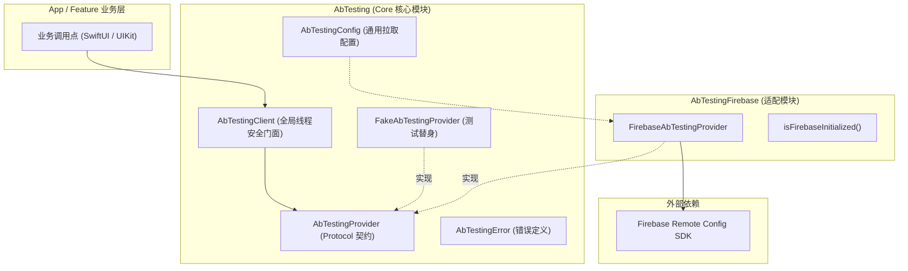
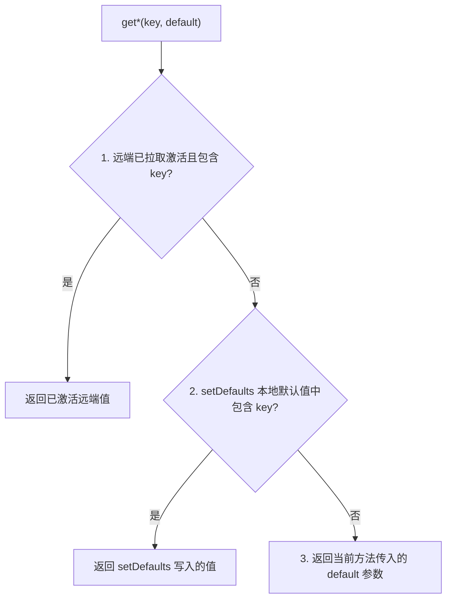

# AbTesting-iOS

[](https://github.com/e-hai/AbTesting-iOS/releases)
[](https://swift.org/package-manager/)
[]()
[](LICENSE)

适用于 iOS 及 Apple 平台的轻量级 A/B Testing / Remote Config 门面封装库。业务逻辑仅依赖统一门面 `AbTestingClient`，切换后端提供商（如 Firebase Remote Config、自研后台）时仅需替换适配器，业务层调用点零改动。

---

## 架构设计



### Target 结构与说明

| Target / Product | 角色说明 | 外部依赖 |
| :--- | :--- | :--- |
| `AbTesting` | **Core 核心**：包含 `AbTestingClient`、`AbTestingProvider`、`FakeAbTestingProvider`、`AbTestingConfig` | 仅依赖 Foundation，**无第三方厂商 SDK** |
| `AbTestingFirebase` | **Firebase 适配器**：封装 `FirebaseRemoteConfig` | `AbTesting`、`firebase-ios-sdk` |
| `AbTestingTests` | **单元测试**：测试 Client 状态流转与 Fake 时序 | XCTest |
| `AbTestingDemo` | **演示工程**：基于 SwiftUI 构建的演练工程 | 本地开箱即用，支持一键切换真实 Firebase |

---

## 取值优先级

读取配置项时，严格遵循以下三层优先级策略，命中即返回：



1. **已激活的远端值**：调用 `fetchAndActivate()` 成功后生效的最新远端下发值。
2. **本地兜底默认值**：通过 `setDefaults(dict)` 写入的键值，在首次启动未拉取或网络不可用时兜底。
3. **方法入参默认值**：调用 getter 时传入的 `default`，防止未定义 key 引发的缺失异常。

---

## 快速接入

### 1. 添加 Swift Package 依赖

#### 方式 A：通过 Xcode 添加
在 Xcode 中打开项目，选择 **File > Add Package Dependencies...**，输入仓库地址：
```
https://github.com/e-hai/AbTesting-iOS.git
```
Dependency Rule 选择 **Up to Next Major Version**，填入 `1.0.0`。

根据需求选择链接的 Library：
- **生产环境**：选择 `AbTestingFirebase`（会自动链接 `AbTesting` 核心）。
- **自研后端 / 轻量环境**：仅选择 `AbTesting`。

#### 方式 B：通过 `Package.swift` 添加
```swift
dependencies: [
    .package(url: "https://github.com/e-hai/AbTesting-iOS.git", from: "1.0.0")
],
targets: [
    .target(
        name: "YourAppTarget",
        dependencies: [
            .product(name: "AbTestingFirebase", package: "AbTesting-iOS")
        ]
    )
]
```

### 2. 初始化与拉取

在 App 启动入口（如 `@main struct SampleApp: App` 或 `AppDelegate`）完成初始化：

```swift
import SwiftUI
import AbTesting
import AbTestingFirebase
import FirebaseCore

@main
struct MyApp: App {
    init() {
        // 1. 初始化宿主 Firebase（本库不越权初始化 FirebaseApp）
        FirebaseApp.configure()

        // 2. 安装适配器
        AbTestingClient.install(
            FirebaseAbTestingProvider(
                config: AbTestingConfig(
                    // 生产建议 3600 秒+；开发调试环境可设为 0 以便实时生效
                    minimumFetchIntervalInSeconds: 3600
                )
            )
        )

        // 3. 设置本地兜底字典并拉取
        Task {
            do {
                try await AbTestingClient.setDefaults([
                    "feature_x": false,
                    "welcome_message": "欢迎使用应用",
                    "max_items": 10,
                    "score_threshold": 0.75
                ])

                let activated = try await AbTestingClient.fetchAndActivate()
                print("远端配置拉取激活状态: \(activated)")
            } catch {
                print("配置初始化失败: \(error)")
            }
        }
    }

    var body: some Scene {
        WindowGroup {
            ContentView()
        }
    }
}
```

### 3. 读取配置

在任意 View、ViewModel 或业务服务中面向 `AbTestingClient` 读取：

```swift
import AbTesting

// 读取布尔开关
let isFeatureEnabled = AbTestingClient.getBool("feature_x", default: false)

// 读取文本字符串
let welcome = AbTestingClient.getString("welcome_message", default: "默认欢迎")

// 读取整数数值
let maxItems = AbTestingClient.getInt("max_items", default: 10)

// 读取 64 位整数数值
let maxItemsLong = AbTestingClient.getLong("max_items", default: 10)

// 读取浮点数数值
let threshold = AbTestingClient.getDouble("score_threshold", default: 0.5)
```

---

## 进阶与最佳实践

### 单元测试与测试替身

在单测 Target 中，只需引入 `AbTesting`，通过 `FakeAbTestingProvider` 进行断言与验证：

```swift
import XCTest
import AbTesting

final class HomeFeatureTests: XCTestCase {

    override func tearDown() {
        super.tearDown()
        AbTestingClient.reset() // 重置全局单例状态
    }

    func testFeatureFlagActivatedFlow() async throws {
        let fake = FakeAbTestingProvider()
        // 设置默认值
        try await fake.setDefaults(["feature_x": false])
        // 预设远端模拟下发
        fake.setRemoteValues(["feature_x": true])

        AbTestingClient.install(fake)

        // 激活前返回默认值
        XCTAssertFalse(AbTestingClient.getBool("feature_x", default: false))

        // 模拟拉取并激活
        let activated = try await AbTestingClient.fetchAndActivate()
        XCTAssertTrue(activated)

        // 激活后返回远端值
        XCTAssertTrue(AbTestingClient.getBool("feature_x", default: false))
    }
}
```

### 自定义 Provider 实现

如需适配自研后台，仅需实现 `AbTestingProvider` 协议：

```swift
import AbTesting

public final class CustomServerAbTestingProvider: AbTestingProvider, @unchecked Sendable {
    public init() {}

    public func setDefaults(_ defaults: [String: Any]) async throws {
        // 保存本地兜底
    }

    public func fetchAndActivate() async throws -> Bool {
        // 请求自研服务端并激活缓存
        return true
    }

    public func getBool(key: String, default: Bool) -> Bool { ... }
    public func getString(key: String, default: String) -> String { ... }
    public func getLong(key: String, default: Int64) -> Int64 { ... }
    public func getDouble(key: String, default: Double) -> Double { ... }
}
```

---

## 运行 Sample 演示工程

本仓库提供开箱即用的 SwiftUI 演示工程：

1. 生成 Xcode 工程：
   ```bash
   xcodegen generate
   ```
2. 双击打开 `AbTestingDemo.xcodeproj`。
3. 默认使用 `FakeAbTestingProvider`，未配置 Firebase 时亦可直接编译并体验全部交互。
4. 如需接入真实 Firebase，将 `GoogleService-Info.plist` 拖入 `Sample/` 并在 `SampleApp.swift` 中启用 `FirebaseApp.configure()` 即可。

---

## License

```text
Copyright 2026 e-hai

Licensed under the Apache License, Version 2.0 (the "License");
you may not use this file except in compliance with the License.
You may obtain a copy of the License at

    http://www.apache.org/licenses/LICENSE-2.0
```
