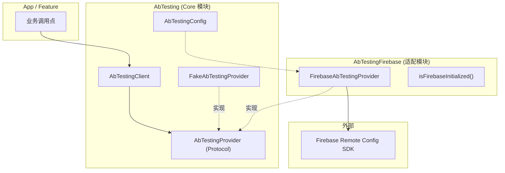
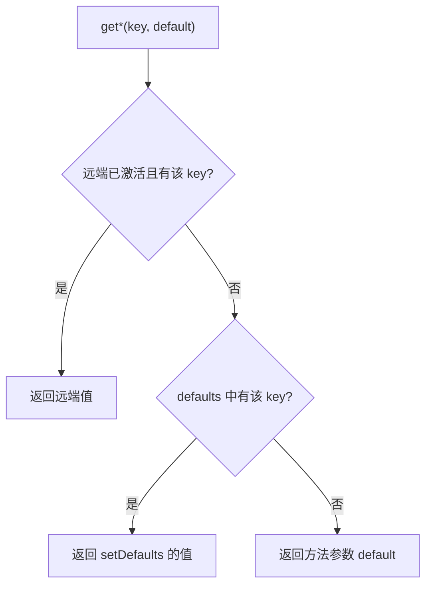

# AbTesting-iOS

iOS / Apple 平台 A/B Testing / Remote Config 封装库。业务只依赖统一稳定 API，切换具体后端时替换适配模块即可。

## 架构



| Product / Target | 说明 |
| :--- | :--- |
| `AbTesting` | Core：`AbTestingClient` / `AbTestingProvider` / `FakeAbTestingProvider`（测试替身） |
| `AbTestingFirebase` | Firebase Remote Config 适配模块 |
| `AbTestingDemo` | 演示 App（无 Firebase 时使用 Fake 跑通流程） |

业务仅面向 `AbTestingClient` 编程；切换后端平台时只需替换 `AbTestingProvider` 实现，业务调用点零改动。

---

## 取值优先级

读取某个 key 时，从上到下命中即返回：

1. **已激活的远端值**（`fetchAndActivate` 成功后生效）
2. **`setDefaults` 写入的本地默认值**
3. **getter 方法参数里的 `default`**（key 完全未定义时的兜底）



---

## 快速接入

### 1. Swift Package Manager 依赖

在 Xcode 的 Package Dependencies 中添加：

```
https://github.com/e-hai/AbTesting-iOS.git
```

并在目标 Target 中添加依赖：
- 生产环境：添加 `AbTestingFirebase`（会自动传递依赖 `AbTesting`）
- 自研/轻量环境：仅添加 `AbTesting`

### 2. 初始化与拉取

```swift
import AbTesting
import AbTestingFirebase

// 宿主需先完成 FirebaseApp.configure()
AbTestingClient.install(
    FirebaseAbTestingProvider(
        config: AbTestingConfig(minimumFetchIntervalInSeconds: 3600)
    )
)

// 设置本地兜底值
try await AbTestingClient.setDefaults([
    "feature_x": false,
    "welcome_message": "Hello",
    "max_items": 10,
    "score_threshold": 0.75
])

// 异步拉取并激活
let activated = try await AbTestingClient.fetchAndActivate()
```

### 3. 读取配置

```swift
let enabled = AbTestingClient.getBool("feature_x", default: false)
let title = AbTestingClient.getString("welcome_message", default: "")
let count = AbTestingClient.getInt("max_items", default: 0)
let threshold = AbTestingClient.getDouble("score_threshold", default: 0.0)
```

### 4. 单元测试与本地验证

```swift
let fake = FakeAbTestingProvider()
fake.setRemoteValues(["feature_x": true])

AbTestingClient.install(fake)
try await AbTestingClient.setDefaults(["feature_x": false])

// 激活前为 false
print(AbTestingClient.getBool("feature_x", default: false)) // false

_ = try await AbTestingClient.fetchAndActivate()

// 激活后为 true
print(AbTestingClient.getBool("feature_x", default: false)) // true
```

---

## 运行 Sample 演示

1. 使用 `xcodegen` 生成项目：
   ```bash
   xcodegen generate
   ```
2. 打开 `AbTestingDemo.xcodeproj`。
3. 默认使用 `FakeAbTestingProvider`，开箱即用，可直观体验默认值到远端激活的过渡与参数刷新。
4. 如需接入真实 Firebase Remote Config，将 `GoogleService-Info.plist` 拖入 `Sample/`，并在 `SampleApp.swift` 中调用 `FirebaseApp.configure()` 即可。

---

## 测试

```bash
swift test --filter AbTestingTests
```
